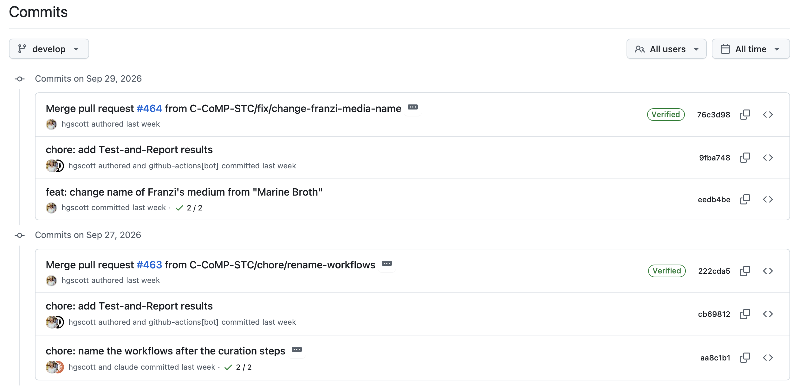
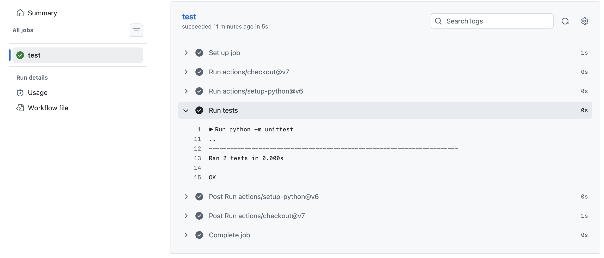
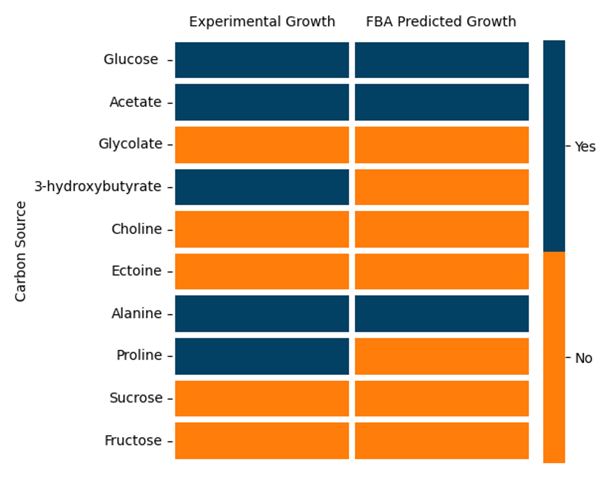

# Continuous Curation: Best Practices for Model Curation Inspired by Software Development

GEMs are, at their heart, a software product, and we took lessons from software development and applied them to the model curation process.
We term this constant testing and iterative model improvement strategy “Continuous Curation”, inspired by Continuous Integration (CI) for traditional software.
This included tracking all changes using version control, having multiple curators collaborate and propose changes by working on branches and opening pull requests, testing the model with defined pass/fail tests, and automatically generating artifacts for curator inspection.

Continuous Curation is not a pipeline or a workflow, you can't install it and hit run.
It is a mindset and a series of practices, that can be tweaked to whatever type of GEM you are making with any sort of data.
The practices we describe here were assembled from traditional software development and from the crystallizing field of GEM curation. There are many different groups of researchers making GEMs and asking themselves how do you make a GEM well.
This document is aimed at a biologist making a GEM or inheriting an existing GEM, and unsure where to start. We hope this document can serve as the reference point for the evolving community practice of making models that are continuously tested and a curation process that is traceable and citable.

## Motivation
GEMs are valuable systems biology products and important tools in integration biology. However as GEMs evolve in their complexity, their management needs to evolve to.
Typically, a GEM may be made by a small group of curators, who turn over frequently (e.g., graduate students or post-docs). After a model is published, other groups may download and modify the model, publishing their own updated versions, resulting in a branching set of models, each with their own curation decisions and assumptions.

Even within a small curation team (even just a single student) working on a GEM fo a bacterium, manual curation is a can be an overwhelming task. The typical advice of just go "pathway by pathway" can be paralyzingly large.

To address challenges in model curation different tools have been developed.
MEMOTE [@lieven2020memote] is a widely used model benchmarking tool that generates a report on the model.
And some coalition around standards to model structure has begun.
standard-GEM is a set of requirements for the format of GEMs versioned with git [@anton2023standardgem].
And groups have developed their own best practices, with certain models, like [Human-GEM](https://github.com/SysBioChalmers/Human-GEM/tree/main/data) and [yeast-GEM](https://github.com/SysBioChalmers/yeast-GEM/tree/main/code) serving as exemplars of model organization.

However, the model file or the structure of the folder containing cannot capture the dynamic process of curation that scientists are actually doing.

We are aware that many of scientists making GEMs are biologists, and that computer scientists telling them the "best" way to do things can be overly complicated.
However, we do want to stress that the GEM curation team will benefit from the increased flexibility of being able to write their own code, regardless of however alluring a walled garden of pretty-looking pre-made functionality may be. Everyone will have different data, every model has its own quirks, it's worth writing your own to really get full coverage of your model.
We hope that templates, and libraries of importable code can help the process, 

These systems do have a cost.
They requires set up and maintenance, and are another thing to handle, in an already long curation to do list.
We hope that this document can convince of their benefit and break down what is needed to begin Continuous Curation with your own model.
In particular, this document aim to address one barrier to entry that has kept some GEM curators for using a system such as this: and unfamiliarity with traditional software engineering tools like Git and automation.

## Background: Primer on Version Control and Automation with GitHub

### What is GitHub?
Version control is critical for model curation because it tracks the “who”, “what”, and “when” of all changes made to the model. Who edited the model file, when did they make the edits, and what exactly was changed. It also maintains the historical versions of the model file, so at any time you can revert changes and return to an older version of the model.

Version control keeps a historical record of changes made to tracked files in a specialized database called a repository (or “repo”). Git is the software tool that enables version control, and GitHub is one popular cloud-based platform to host Git repositories, that also offers other functionalities such as issue tracking and wiki hosting. While we used GitHub, and will use GitHub-focused terminology (e.g., pull requests, actions) it not the only option for hosting Git repositories, other popular options include GitLab, Bitbucket and Azure DevOps, each of which have analogous tools to those we describe here and could similarly be used for a continuous curation pipeline.

A Git repository lives in two places, locally on your computer, and on a remote server. The two copies of the repository are respectively called the "Local Repository" and the "Remote Repository".
You will be actively working on your local repository, and periodically syncing your changes to the remote repository. The three basic commands for tracking and syncing your commands are `commit`, `push`, and `pull`.


`commit` is done locally, to save your changes, along with a "commit message". Each commit has a hash, so you refer to the exact version of the code. Commits also track who makes the commit and when. So all changes are attributable.
Because commits flag specific versions in the code, it is recommended to commit often (i.e., multiple times a day), and to leave a helpful commit message so if you are going back through your commit history you will know what version is which.



`push` syncs all of the commits that have been made to your local repository to the remote repository. Making all of your changes available on GitHub to other people. It is not necessary to push every commit individually, but you should push regularly, especially when working as a group so that your version is not significantly ahead of other people's copies. One maxim is to "Commit often, push daily".

`pull` is the inverse of `push`, it syncs any new changes from the remote repository to your local repository. This might be done if a collaborator has made changes on their own local copy, pushed it to the remote, and now you need those changes on your local repository.

Pushing and pulling frequently ensures that your local copy is never too far ahead or behind the remote repository.

We will not discuss here the mechanics of how to make a repository or execute commands, for that see one of the many available Git tutorials, for your chosen platform, e.g.:
* [GitHub Hello World Tutorial](https://docs.github.com/en/get-started/using-github/hello-world)
* [GitHub Desktop Tutorial](https://docs.github.com/en/desktop/overview/getting-started-with-github-desktop)
* [GitHub in VSCode](https://code.visualstudio.com/docs/sourcecontrol/github)

#### Diffs
A diff (short for difference) is a visual way to see the changes made to a file.
They are a quick and easy way to see how a file has changed, and so are very valuable when reviewing changes or looking for a specific edit.

 On GitHub, diffs are typically shown with two versions of a file side-by-side (e.g., the older version and a new edited version). The old version of the file on the left, and the new version on the right. The lines of the file are aligned so that the matching content in the file lines up with each other, regardless of insertions and deletions.

Additions to the file are highlighted in green and marked with a `+` to the left of the line. Deletions to the file are highlighted in red and marked with a `-`.


Not all diffs are equally helpful. Binary files do not have a readable raw format. So they cannot show what lines were changed on a commit, only that the file was edited somewhere.
For that reason, it is recommended to avoid using binary files (e.g., xlsx).

For example, if you edit one row in an excel file, and commit the change, the diff will only show 
    * File types to avoid
        * Microsoft office files: e.g., xlsx


For a more in depth coverage, see [@chacon2014progit].

#### Branches
Branching is a key feature of Git- it allows developers to isolate their changes so that the main version of the repository is not affected. This allows multiple developers to work simultaneously, and allows developers to test out changes where they will not affect anyone else.

A branch is an isolated version of the repository that lives in parallel to all other branches. Changes made on one branch do not affect the other branches.

Merging is the process of integrating all of the changes from one branch into another. When using GitHub, merges are often (though not necessarily always) started by opening a Pull Request.

A Pull Request is a request to merge two branches, that can be commented on or reviewed by others.

### Unit Tests
It is a truth universally acknowledged that not all code is equally good.
Code may have bugs, or have unexpected behaviors, or may be written in such a way that it is inflexible to changes/additions, and difficult to maintain or use.
One way to guard your code against such issues is to write and regularly run tests for your code.

Unit tests are a common software development practice in which the smallest individual parts of the code (called units) are individually tested, to ensure each gives the expected outcome, and are considered critical to the success of any software development project.

Far from being an after-thought or nice addition to code, unit tests should be thought of as equally important to your "production code" (your code that actually runs your new program or is run by end users). Tests should be clean, documented, and maintained.
While there is a time and effort cost when it comes to designing, writing, and maintaining tests, the ability to find and diagnose problems is valuable enough to be worth it.

#### Python Example
Here we will show a step by step example for how to write a test for a python function.
There are multiple testing frameworks for python, this example (like all the unit tests on MIT1002-GEM) will use the python standard-library testing framework, `unittest`

Imagine you have a python module called `hello` with a single function, also called `hello`, that says "Hello" to a person, given their name.

Your function, might look like this:
```python
def hello(name: str):
    message = 'Hello, ' + name + '!'

    return message
```

To write the unit test, you would make a new file, by convention in a directory named `test` or `tests`, and name the file `test_{module name}.py`, for that individual python module, so in our case `test_hello.py`.

In your test file, you first need to import the library `unittest`, and the function (`hello`) that you are testing:
```python
import unittest

from hello import hello
```

For `unittest`, all tests are put within a class, so we will first define a class called `TestHello`:
```python
class TestHello(unittest.TestCase):
```

Within that class you can write multiple tests, each defined as a function. We will write two tests for `hello`. The first test will check that we receive the expected output given an given input. In this case, the input is the name "Helen", and we can check that the output of the test is correct using an assert statement. `assertEqual` compares the string that we receive from `hello` to "Hello, Helen!", if the strings are not equal to one another, the test will fail.

```python
    # Note this block is indented because it will sit within the class `TestHello`
    def test_helen(self):
    """Test that hello prints the expected message for the name Helen"""
        # Define a name
        name = 'Helen'
        # Call the function
        message = hello(name)

        # Assert that the function returns the correct string
        self.assertEqual(message, 'Hello, Helen!')
```

We can then define a second test within the `TestHello` class to test edge cases or ways we expect the function to fail. For example, if someone were to provide a number rather a string for the name, we expect that the function will fail. To test that case, our test function could be:
```python
    def test_integer(self):
    """Test checking that the function fails when an integer is passed"""
        # Define a name
        name = 123
        # Call the function
        with self.assertRaises(TypeError):
            message = hello(name)
```
Here, rather than using `assertEqual` we use `assertRaises` to define that the expected outcome when `hello` is provided with a number (e.g., `123`) would be to raise a `TypeError`.

At the end of the test file, we add the following block to set it to run all of the classes of tests, and all of their test functions whenever the test is ran, with:
```python
if __name__ == '__main__':
    unittest.main()
```

To run our tests, we run the test file with python:
```bash
python -m unittest
```

And in the terminal we receive the following test output:
```
..
----------------------------------------------------------------------
Ran 2 tests in 0.000s

OK
```

In the case of a test failing, the test output would look like:
```
F.
======================================================================
FAIL: test_helen (tests.test_hello.TestHello.test_helen)
Test that hello prints the expected message for the name Helen
----------------------------------------------------------------------
Traceback (most recent call last):
  File "/Users/helenscott/Documents/PhD/Segre-lab/hello/tests/test_hello.py", line 16, in test_helen
    self.assertEqual(message, 'Hello, Helen!')
    ~~~~~~~~~~~~~~~~^^^^^^^^^^^^^^^^^^^^^^^^^^
AssertionError: 'Hi, Helen!' != 'Hello, Helen!'
- Hi, Helen!
?  ^
+ Hello, Helen!
?  ^^^^


----------------------------------------------------------------------
Ran 2 tests in 0.001s

FAILED (failures=1)
```

#### Assert Statements

This example used two different assert statements, `assertEqual` and `assertRaises`. There are many other assert statements that make sense for different kinds of tests. here is a list of just some examples of potential assert statements.

| Assert Statement | What it does |
|------------------|--------------|
|`assertEqual` | Checks that two objects are equal |
|`assertAlmostEqual` | Checks that two objects are equal when rounded to the given number of decimal `places`. |
|`assertLess` | Checks that the first object is less than the second|
|`assertLessEqual` | Checks that the first object is less than or equal to the second |
|`assertTrue` | Checks that the expression is true |
|`assertFalse` | Checks that the expression is false |
|`assertIn` | Checks that the first object is in the second |
|`assertIsNone` | Checks that an object is `None` |
|`assertRaises` | Checks that exception of specified class is raised |

#### Good Tests come F.I.R.S.T.
When writing tests for your code, keep in mind the following acronym [@martin2008clean].

**F: Fast**

Tests are designed to be run often and running them should not be a burden. If a test is slow, there is a high likelihood that people will skip the test, and a test that doesn't get run is no good to anyone. If the function you are testing is designed to work on  large data types (e.g., sequencing data), you can make a mock smaller version of the data for the test rather than running on a real example.

**I: Independent**

Each test should be able to pass or fail independently, and not depends on another's state or on run order.

**R: Repeatable**

Your test must work the same every time, regardless of who is running it, where or when they are running it. If your test or the code it is testing relies on randomness set a seed, so that the test will use the same number every time. A test that sometimes passes and sometimes fails for no real reason, will train people to ignore it or just keep rerunning it until it passes.

**S: Self-Validating**

Your test should be self-validating, meaning that a human does not need to look at the output to decide if the fail passed or not. This results in each test giving a boolean (True/False) result.

**T: Timely**
Tests should be written in a "timely" manner, meaning that unit tests should be written immediately before writing the code/function they are testing.
While writing a test before there is something to test seems counter intuitive, it is the core principle of Test-Driven Development (TDD) [@beck2003test].
In this system, you initially write a test that **will** fail, because it has no function/code to actually call. And then write the minimal function needed to pass that test. Before adding any additional functionality to the function/code you must first write a test that could fail.

While test-driven development has been long discussed, it is not universally used, and in the case of model curation it is not necessarily clear that you can write a test before model curation.

You can think of the data your model is trying to recreate (e.g., growth phenotypes) as a form of TDD. In normal software engineering, the developer can define what the function/code should be doing, but for a model, the curator can not serve as an oracle, but instead requires validation data.

<!-- TODO: Fill in the table
| Example of bad unit tests | Example of unit unit tests|
|----------------------------|--------------------------|
| Generate a figure, that you need to look at | Test that a script generate the correct data and saves a plot with the correct path |
| A test you know will fail, and you will just ignore it (skip the test or mark it a known failure instead)| |
| TODO | TODO |
-->

Here we showed tests being run manually, where a developer would need to run `python -m unittest` on their own computer and verify that all the tests pass. To ensure that tests and never forgotten, or that a failure is missed, tests can also be run automatically (e.g., as part of a workflow on GitHub Actions).

### Automation with GitHub Actions
GitHub Actions is tool built in to GitHub that can run pre-defined workflows on GitHub servers. It is typically used in software development for Continuous Integration testing and for automated deployment.

For example, you can set up an action to run all of your tests, so that you are not dependent on everyone running the tests locally.

#### Defining an Action with a YML file
The steps of an Action are defined in a workflow file.
Workflow files use YAML syntax, and the files must end in `.yml` or `.yaml` and must be stored in `.github/workflows` in the repo.
For more information on YAML see: [Learn YAML in Y Minutes](https://learnxinyminutes.com/yaml/) and the [GitHub Workflows and Actions documentation](https://docs.github.com/en/actions/reference/workflows-and-actions).

For an example we will walk through a YAML file for automated running of the tests for our `hello` module that we wrote above.

We first define the name of the workflow, this will show up in the Actions tab on GitHub.

In the YAML file we write:
```yaml
name: Test-Hello
```

Then we define what will trigger this Action to run. For this example, we will set it so that the Action runs whenever changes are pushed to the repo, using the keyword `push`.
```yaml
# Run this every time anything is pushed to the repository
on: push
```

Other possible triggers for a workflow are: `schedule`, to run on a specific schedule (e.g., every day, and `workflow_dispatch`, to run only manually triggered with a button. For a complete list of the workflow triggers see the [GitHub Actions documentation](https://docs.github.com/en/actions/reference/workflows-and-actions/events-that-trigger-workflows).

The next section in the workflow file, `jobs`, defines the actual work done in the workflow. There can be one or more jobs that can run sequentially or in parallel.

In this YAML file we will only have one job, `test`.
```yaml
jobs:
  test:
```

Within `test`, we first define the computer environment that this job will be run in.
GitHub Actions run on a "Virtual Machine" on GitHub servers that function like a completely fresh computer where you can install any tools or software you need isolated from the rest of the actual host hardware.
This environment starts totally clean every time, so you can always test what it would be like to start on a totally new computer, this is good because you know exactly what needs to be done/installed (you never have a "well it runs on my machine" moment), but it does mean you need to set it up with every run.
We will use a specific version of the Linux environment "ubuntu":
```yaml
    # This is indented because it is within `test`
    # The machine it runs on
    runs-on: ubuntu-22.04
```

The job is defined by a series of `steps`, a sequence of tasks that will be executed as part of the job.
Each step can be named with `name`, and either calls a published action with `uses` or executes shell commands in the runner with `run`.
Since we are starting in a totally blank virtual machine, the first few steps are usually dedicated to setting it up.

First we muse check out the repository, so our virtual machine has all of the code on our repo. Because this is such a common task, there is a published action, `checkout`, that we can call that will handle all of the necessary sub-steps to checkout our repository.
Then we install a specific version of Python to our virtual machine. Specifying the version of python, rather than using the latest version is good, because it won't drift as Python is updated, so things won't break.
```yaml
    steps:
      # Copy the repository onto that machine
      - uses: actions/checkout@v7

      # Put a known version of Python on it
      - uses: actions/setup-python@v6
        with:
          python-version: "3.11"
```

The final step is to actually run the tests as we did locally before:
```yaml
      # Run them
      - name: Run tests
        run: python -m unittest
```

When we push to our repository, and this test runs, we can see the workflow running in the Actions tab:


And when the workflow is complete we get a clear if your test passed or failed:


When we look at the individual run of the workflow, we can see our named job, `test`, in the case of a workflow with multiple jobs, this diagram would have more boxes.


And can see the full test output:



Running tests as part of a workflow is very helpful, because your tests will run with every change, you never need to run the tests yourself, or count on other people running them.


If our test were failing, you would instead see a red "X" when the workflow is complete.


And in the case of a workflow with multiple jobs, you can pinpoint which job was failing.


And as before, you can see the full test output, which will now show you which test was failing and why:


## Setting-Up a GEM Repository
Having established the pre-requisite knowledge of using GitHub, and writing/running tests and workflows. This section will now walk you through how to set up a GitHub repository specifically for a "continuously curated" GEM.

### What's in a Name?: Choosing your Repository and Model Name
To create a GitHub repository, you must select a name. The name must be unique to the GitHub account that owns the repository, and should be short yet descriptive.

standard-GEM requires that the repository and model file have the same name and that the name is a short name followed by "-GEM". The short name can be a common name, the KEGG organism, or taxonomy-derived short name (e.g., Human-GEM, yeast-GEM, MIT1002-GEM).

This differs from the naming convention used by the BiGG GEMs, notably the widely used *E. coli* models.
BiGG names models following a pattern, of i{Author's Initials}{Number of genes in the model} [@reed2003ijr904].
The i in the name refers to an in silico model (that is, a computer model)
For example: iJR904 is an in silico model (i), built by Jennifer Reed (JR), containing 904 genes (904). Recent *E. coli* models are iML1515, where M and L presumably stand for 
Monk and Lloyd the two first authors of the related paper, and iJO1366 is by Jeffrey Orth.

While this naming is very descriptive, it is inherently a snapshot, and would have to be continuously updated as the model evolved. For example, every time you add or remove a gene you would need to change the number, and as new curators contribute to the model or take over, the author list may expand or change. It also does not capture how models are related. For example, from the name it is unclear if iML1515 is a revised and expanded version of iJO1366 or of it was a whole new *E. coli* that was built independently.

With the standard-GEM format, the model name is now only organism specific, and so will remain accurate as the model is updated. Discrete versions of the model (e.g., Human-GEM 2.0.0) can capture the snapshot of the model in time without losing track of how model versions are related.

### Branching Strategy
By default GitHub will create a single branch called `main`. We will also immediately create a second branch, called `develop`.

Both of these branches will be "long-lived", meaning they will never be deleted.

`main`, will have the official releases of the model, and `develop`, will be the branch where all of the accepted changes to the model are integrated before an official release. All changes made the model will be made on short-lived feature branches that branch off of and are merged back into `develop`. This will ensure that any new feature development will not disturb the main model.


### Repository Structure
Following and building upon the Standard-GEM [@anton2023standardgem] specification, the MIT1002-GEM repo is structured as:
```
MIT1002-GEM/
|-- .github/
|   |-- ISSUE_TEMPLATE/
|   |-- workflows/                  # CI, release, standard-GEM update
|   |-- CONTRIBUTING.md
|   `-- pull_request_template.md
|-- code/
|   |-- test/                       # assert pass/fail; block a merge
|   |-- scripts/                    # generate artifacts for a human to read
|   |-- tools/                      # shared importable functions
|   `-- ...                         # exploratory analyses (biomass, pangenome)
|-- data/
|   |-- deprecated_identifiers/     # what was removed, and why
|   |-- known_growth_phenotypes.tsv
|   `-- README.md
|-- docs/
|   `-- continuous-curation.md
|-- model/
|   `-- MIT1002-GEM.xml             # the only model file on develop
|-- .standard-GEM.md                # checklist for standard-GEM requirements
|-- CHANGELOG.md
|-- README.md
|-- requirements.txt
`-- version.txt
```

#### `.github/`
The `.github/` directory holds all GitHub-specific configuration files (e.g., the contributing guidelines, code of conduct, issue templates).
The `workflows` subdirectory within it, holds the YAML workflow files used by GitHub Actions.
In MIT1002-GEM we have 5 workflow files, the specific workflows will be described in detail in [the following section](#the-continuous-curation-loop)

#### `code/`
Standard-GEM requires a `code` directory to house all the code used in generating the model. We further refine `code` into 4 categories
* Tests
* Scripts
* Tools
* Exploratory Analyses

Tests are the unit tests (as described [above](#unit-tests)) for the repository.

Scripts are python files that are run automatically like tests, but they do not “pass” or “fail”, and instead generate artifacts (e.g., plots, reports) for a human curator to look at. 

Tools are the shared helper functions, definitions, and command-line utilities a curator runs deliberately, either by hand, or imported by the above. If there is a task you find yourself doing repeatedly, it should be a tool, not re-written in multiple files.

Exploratory Analyses are all of the other directories within `code`.
Each directory was a one-off for a specific question is an exploratory analysis and can live in its own directory, e.g., `biomass` or `blast`

#### `data/`
This folder contains the data used in generating the model. It must also include a README.md file that describes how the folder is organized.

#### `model/`
This directory houses your model file(s).
The model file should have the same name as your repository ({something}-GEM).
There are many different file formats that you can use (e.g., JSON, MATLAB, SBML, etc).
Different tools use different file types, and different users may have their own preferred file types, so it is typical (and required by standard-GEM) to have your model available in multiple file types.
However, we strongly recommend that you pick one file type to be your "default" and have only that file on your `develop` branch, and export the model to all other file types only on the `main` branch.
While this means the most up-to-date model will not be available in all file types, it does remove the risk of different curators making edits on different files and them becoming out of sync, or the changes being lost. 

##### The SBML File Type
We chose to use the Systems Biology Markup Language (SBML) [@sbmlLevel3Version2CoreRelease2] file type as our default file and the only file type on our `develop` branch.
SBML is a file format and markup language encoded in the the eXtensible Markup Language (XML) which is used for storing, transmitting, and reconstructing data.
SBML was specifically designed for representing computational models in a declarative form that different software tools can read, so one file type can be used for multiple scales.
An extension to SBML, called the Flux Balance Constraints (fbc) package which adds the necessary attributes for FBA [@olivier2018fbc2].

The major advantage of using SBML over other file types is that SBML is formally defined, so files can be validated.
Note these specification only constrain the form of the file, not the biology they represent, so a totally valid SBML file could still be biologically incorrect.

Importantly, SBML files are plain text,  so you can open it and read the raw file yourself (i.e., it's not binary), which also means it diffs cleanly.

While most of the time, you don't need to read an SBML file directly, as you work with the model as an object loaded into a tool (e.g., COBRApy), it is very helpful to be comfortable reading it, e.g., for when you are looking at a diff and want to see what changed in the model.

SBML looks can look intimidating at first, but the format is straight forward once you learn a few mechanics of the file.

SBML, like all XML files is comprised of a series of elements.
A element is contains a series of information and is bracketed by a start-tag and end-tag.
For example, a element of the type "species" is written as `<species> ... </species>`.
Note that an empty element (i.e., one with no children) can close itself with `/>`, e.g., 
`<compartment id="c0" constant="true"/>`.
A element can include two types of information: attributes, and child elements.

Attributes are pieces of information that live inside the opening tag, and are restricted to simple values. You can think of attributes as writing on the outside of a box, it labels what is inside the box, but it doesn't actually contain anything.
In an SBML file, attributes come immediately after the opening tag and are a series of keys and values, for example, in this `species` tag, the `id`, `name`, and `fbc:charge` are all attributes.
```xml
<species id="M_cpd00443_c0" name="4-aminobenzoate" fbc:charge="-1"/>
            |-------- all three of these are attributes --------|
```

Child elements are elements within other elemtns, each bracketed by their own start- and end-tags. You can think of these as a box within a box.
Whereas attributes were simple values stored in key-value pairs, a child element can include multiple elements or something with parts of its own.
In the SBML file, a `reaction` element, has the child element `listOfReactants` and that in turn has a child, `speciesReference`, with indentation showing the nesting of children within their parents.
```xml
<reaction id="R_octanoyl_xfer" reversible="false">   <-- attributes
    <listOfReactants>                                  <-- a child element
        <speciesReference species="M_cpd11470_c0"/>      <-- a child of that child
    </listOfReactants>
</reaction>
```

SBML files of GEMs have many different types of elements, the table below includes several key elements and the information they hold.

| Element | Holds |
|---|---|
| `<listOfUnitDefinitions>` | units |
| `<listOfCompartments>` | c0, e0 |
| `<listOfSpecies>` | metabolites |
| `<listOfParameters>` | the flux-bound values |
| `<listOfReactions>` | reactions |
| `<fbc:listOfObjectives>` | what FBA maximizes |
| `<fbc:listOfGeneProducts>` | genes |

To read and understand XML and SBML files, the key thing to understand is that elements do not contain all of their related information, instead they point at other elements. For example, in a GEM, a `reaction` element will not contain all of the `metabolite` elements that are involved in it, instead, `reaction` points at other `metabolite` elements. The `reaction` element for "Octanoyl transferase" may look like:
```xml
<reaction id="R_octanoyl_xfer" name="Octanoyl transferase" reversible="false"
    fbc:lowerFluxBound="cobra_0_bound" fbc:upperFluxBound="cobra_default_ub">
<listOfReactants>
    <speciesReference species="M_cpd11470_c0" stoichiometry="1" constant="true"/>
</listOfReactants>
<listOfProducts>
    <speciesReference species="M_cpd11493_c0" stoichiometry="1" constant="true"/>
    <speciesReference species="M_cpd14953_c0" stoichiometry="1" constant="true"/>
</listOfProducts>
<fbc:geneProductAssociation>
    <fbc:geneProductRef fbc:geneProduct="G_WP_049588698__46__1"/>
</fbc:geneProductAssociation>
</reaction>
```
The metabolites involved in the reaction are included in `listOfReactants` and `listOfProducts`, but the metabolites themselves are not defined there, instead the child element `speciesReference` points to the metabolite definition, by using the same ID in `species` as a metabolite.
For the "Octanoyl transferase", the `listOfReactants` has only one `speciesReference`, and its ID for `species` is "M_cpd11470_c0". Within `listOfSpecies`, one `species` element has that ID, it's full definition is as follows:
```xml
<species metaid="meta_M_cpd11470_c0" sboTerm="SBO:0000247" id="M_cpd11470_c0" name="Octanoyl-ACP" compartment="c0" hasOnlySubstanceUnits="false" boundaryCondition="false" constant="false" fbc:charge="-1" fbc:chemicalFormula="C19H35N2O8PRS">
</species>
```
From this definition, we can see that `M_cpd11470_c0` refers to "Octanoyl-ACP", and other attributes give the compartment, charge, and formula.

These examples showed a few quirks of SBML files written by COBRApy, including ID prefixes and escaped characters.
In the example reaction, the ID was `R_octanoyl_xfer` and the example metabolite's ID was `M_cpd00443_c0`. However if you were to read this model into COBRApy and look for the same IDs, you would not find them, instead you would find a reaction `octanoyl_xfer` and a metabolite `cpd00443_c0`. This is because COBRApy adds prefixes to each ID: `R_` for reactions, `M_` for metabolites, and `G_` for genes, and then strips them when actually reading the file.
These prefixes are added to ensure that IDs will satisfy all requirements from SBML, mainly that SBML IDs must begin with a letter or underscore, and that SBML IDs have to unique across the whole document (i.e., not just within the metabolites or reactions). By adding `R_` or `M_` this ensures that even the same ID for a metabolite and a reaction are still different, and that they begin with a letter.
In the example reaction, `R_octanoyl_xfer` is associated with the `geneProduct` "G_WP_049588698__46__1". The `__46__` may look malformed or like corrupted code, but it represents a period. SBML IDs can't contain periods, so COBRApy encodes them as `__` plus the ASCII code (46=`.`). `G_WP_049588698__46__1` is really `WP_049588698.1`.

## The Continuous Curation Loop


The Continuous Curation loop consists of 6 steps:
1. Curate
2. Test
3. Report
4. Release
5. Run
6. Monitor

We used GitHub Actions to automate running tests, generating reports, and releasing the model.

### Step 1) Curate
*NOTE: We do not discuss here how to make curation decisions, but rather how to implement them*

When curating a GEM in a continuous matter it is important to break curation up into small, discrete tasks, rather than treating all of model curation as a single monolithic task.
The heart of Continuous Curation (like Continuous Integration) is to do many small curation tasks, and update the model with small changes frequently.

This begs the question of exactly how big one task should be.
While it is hard to say definitively how big a task may be a general guideline is to aim for a task to take on the order of days (up to a maximum of a week) to address.

When curation focuses on matching growth phenotypes (i.e., gap-filling to make the model grow on certain media), an obvious unit is to address each media separately.
However, early on in this process (i.e., for the first round of gap filling to grow on the very first medium) this tak may be unmanageably large.
instead, you can break "growth" on a given media into the production of each individual biomass components and gap fill for production of a given biomass component one by one.
Once all biomass components are producible, gap-filling for any additional carbon source is typically a small enough task to treat as one task- gap-filling for transporters and a catabolic pathway.

Once a task has been decided upon, create a feature branch off of the `develop` branch with a brief yet descriptive name of what it is you are trying to address.
For MIT1002-GEM we named our feature branches much like commits (see below), with a prefix followed by a slash and more descriptive name, similar to the style used by the git-flow tools. For example the branch `feat/gapfill-for-glucose` could be used for adding the ability of the model to grow on glucose.

#### Removing Reactions/Metabolites

It is an established best practice to keep a list of all reactions and metabolites removed from the model, as removing an element from the model is just as an important decision as adding something to the model.

<!-- TODO: Fill in
* Palsson said to do it [@thiele2010protocol]
    * TODO: Actually I can't find it in this paper, is it from something else?
-->

And in the Human-GEM repository, curatiors maintain a tables for the [removed metabolites](https://github.com/SysBioChalmers/Human-GEM/blob/main/data/deprecatedIdentifiers/deprecatedMetabolites.tsv) and [removed reactions](https://github.com/SysBioChalmers/Human-GEM/blob/main/data/deprecatedIdentifiers/deprecatedReactions.tsv), and remind curators to use these tables by including a check-box list in the PR template.
Whenever someone opens a PR, the final section of the PR is a series of statements the opener must "check off", one of which is "Any removed reactions and metabolites have been moved to the corresponding deprecated identifier lists".
We took inspiration from these tables and the PR template, and added additional information and tooling to make the tables more informative and to enforce their use.

In MIT1002-GEM the removed metabolite and reaction tables are saved in [`data/deprecated_identifiers/deprecated_metabolites.tsv`](https://github.com/C-CoMP-STC/MIT1002-GEM/blob/main/data/deprecated_identifiers/deprecated_metabolites.tsv) and [`data/deprecated_identifiers/deprecated_reactions.tsv`](https://github.com/C-CoMP-STC/MIT1002-GEM/blob/main/data/deprecated_identifiers/deprecated_reactions.tsv) respectively.
The use of snakecase (e.g., `deprecated_identifiers` rather than Human-GEMs `deprecatedIdentifiers`) is purely a style choice and came from the MIT1002-GEM developers being python programmers.
These tables were based on the `deprecatedIdentifiers` tables in Human-GEM, but do include several new rows, This includes a reason for the removal, chosen from the following controlled vocabulary: duplicate, id_changed, no_genomic_evidence, no_experimental_evidence, mass_imbalance, infeasible_cycle, dead_end, orphaned, erroneous_annotation, out_of_scope, and unknown. Other information included in this file is the pull request of the removal (automatically added for all new entries when a pull request is opened) and the date.

One things we wanted to add was a list of the removed reactions within the model file itself.
This was added to ensure that someone who downloads the model file without cloning the whole GitHub repo, still has this vital information.
In the model file, lists of the IDs of the removed reactions and metabolites are stored in the “notes” element, which survives the model being read and re-written by libSBML and COBRApy. 

 Note that the process of removing a reaction from the model is structured: a helper function was written to both remove an entity from the model and add it to both lists. Unit tests ensure that the TSV files are well-formed, that the list in the model mirrors the TSV files, and that entities in the deprecated lists are not present in the model (i.e., things that were removed were not re-added).

#### Commits
While making your curation changes, you should commit your changes often.
Don't just wait until the end of all your changes to make one single commit.
When you make a commit, be sure to make your commit messages, concise and descriptive.
You want your commit messages to remind you what you did at any given point, so if you ever need to revert changes or find a specific version of the model in the repo's commit history you can find it easily.
Something like `curated model` or `update` do not tell you what you actually did, and also may be a sign that you have waiting to long to commit since you cannot say what you did concisely enough to fit in a commit message.

Following standard-GEM, you should use "semantic commits".
In semantic commits, all commit messages are formatted as `<type>[optional scope]: <description>`.
Where `<type>` is chosen from a controlled vocabulary:

* chore: updating toolbox, data files, etc.
* doc: updating documentation or explanatory comments in functions.
* feat: new feature added, e.g. new reaction / metabolite / function / etc.
* fix: something that was incorrect in the model and now has been corrected.
* refactor: see code refactoring.
* style: minor format changes of model, functions or data (spaces, semi-colons, etc., no code change)

`scope` is an optional part of the message that refers to the receiver of the action, i.e. what part of the model/data are you modifying, such as "rxn" for a model reaction.

Finally the `<description>`, is the most important part of the commit message, and is the concise description of what you did.

Some examples of good semantic commit messages from the yeast-GEM repository are:

|commit|commit message|
|:---:|:---:|
|Add new rxns|`feat-rxn: methanol pathway`|
|Remove a metabolite|`fix-met: duplicated citrate`|
|Add metabolite formula|`feat-met.prop: carbohydrate formulas`|
|Fix rxn stoichiometry|`fix-rxn.prop: complex V stoich coeffs`|
|Update gene IDs|`fix-gene.annot: update IDs from SWISSPROT`|
|Format name of compartment|`style-comp.annot: remove uppercases`|
|Split a rxn in 2|`refactor-rxn: split isomerase in 2 steps`|
|Add some data|`feat-data: metabolomics data`|
|Update documentation of function|`doc: addDBnewRxn.m`|
|Update toolbox|`chore: update RAVEN version`|

#### Pull Requests
One critical component of the history of changes to the model is the “why”- why was a change to the model made (e.g., was a reaction found to have genomic evidence, was there a mistake in the biochemistry database, etc.). There are text fields in the model file itself where this information can be stored, and there have been cases in the past of defined “codes” used to represent different types of evidence that support each reaction [@thiele2010protocol] (they used numeric codes 4 = direct biochemical evidence, 3 = genetic evidence, 2 = sequence/homology evidence, 1 = physiological evidence, 0 = no evidence (included only because it improves modeling)) however we have found that these are not well used, lack standardization across the community, and are often not comprehensive enough to fully explain the reasoning behind each change. We instead elected to document these in issues and pull requests on the repository. Issues can be used as a sort of electronic lab notebook. To ensure that all curators (present and future) are reminded to document their reasoning, a pull request template was used.

The workflows set up with GitHub actions trigger upon the opening of a pull request, that starts the cycle with the automated testing and reporting.

### Step 2) Test
Just as testing code with unit tests is important, it is important to write and regularly run tests for a GEM.
Typical software testing tools can be used, but some concepts need to generalized.
In traditional software engineering, the unit being tested is often a function, however for the case of model curation, we are testing the model as a whole, but can write tests to focus on individual aspects of the model.

<!--TODO: Fill In
* TODO: Why testing a model is not like testing a function [@kanewala2014testing]
-->

The core things you want the tests to tell you is if your model is correct.
This is hard because for the most part, we have no ground truth as to what a model should me

Some examples include, testing that:

* the model file is valid SBML (using COBRApy's function `validate_sbml_model`)
* the model cannot grow on no carbon
* the model cannot produce ATP without carbon (using MEMOTE's function `detect_energy_generating_cycles`)

Some of these tests use previously published tools, but we found that by implementing them with unit tests on a GitHub action it was possible to pass or fail a test, which can hlp curators recognize errors introduced into the model quickly.

The obvious place where we had ground truth information for MIT1002-GEM was the growth phenotypes.
So we wanted to unit test to check that the model was able to recreate the growth phenotypes, as that was our primary goal in model curation.
However, this test posed a problem- if you implement a test to check that all model phenotypes match early in the curation process it will continuously fail for a long time (MIT1002-GEM v4.0 would still fail this test today). However, if you wait to implement the test until all the growth phenotypes do match (i.e., late in the curation process), it might not help at all.

We instead implemented the test to make sure that the model never performed worse than it did before- e.g., that a growth phenotype where the model could grow before doesn't revert to no growth.
This was implemented by tracking a "baseline performance" of how the growth phenotypes matched at the previous version of the model, and comparing against that. If the model performance stayed the same or got better (e.g., a false negative switched to a true positive) the test passed, however if the model performance got worse (e.g., a true positive switched to a false negative, or a true negative switched to a false positive), the test failed.

#### GitHub Action
In MIT1002-GEM we run all our tests automatically in the CI-workflow `Test-and-Report`, which runs whenever a pull request is opened or changes are pushed to the PR branch

The YAML file below includes the preamble for `Test-and-Report` and the the `test` job:
```yaml
name: Test-and-Report

on:
  pull_request:

jobs:
  test:
    runs-on: ubuntu-22.04
    steps:
      # Checks-out your repository under $GITHUB_WORKSPACE, so your job can access it
      - uses: actions/checkout@v3
        with:
          ref: ${{ github.head_ref || github.ref_name }}
          fetch-depth: 0

      # Install everything I need
      - name: Install Dependencies
        run: |
          python -m pip install --upgrade pip
          python -m pip install -r requirements.txt

      # Run the custom tests
      - name: Run Custom Tests with pytest
        run: pytest
```


### Step 3) Report
The report phase automatically runs scripts stored in `code/scripts` to generate artifacts (e.g., plots or reports) for human inspection.

Several of the key reports used by curators were the growth phenotype report and the biomass component producibility report.

The growth phenotype report is heatmap visualization of the model results for the experimental growth phenotypes, useful for sharing results:

For example, for an early version of the the MIT1002-GEM, we had a the following growth report.
With colors for the binary results of growth and no growth for both experimental data and the FBA simulations with the model.



While this graph is useful to grasp model performance at a glance, it was not the most instructive when gap-filling the model (just knowing that the model does not grow does not help you find a gap). Instead we checked the model’s ability to produce each individual biomass component (i.e., we added a demand/sink reaction for each biomass component that take the metabolite and removes it from the system (similar to an exchange reaction), and looped through the list of biomass components and set each as the objective, maximizing the flux through that sink reaction. A positive value indicated that the model was capable of producing that biomass component. This helped narrow down searches for gaps (e.g., could say that a subset of amino acids was not producible, therefore there must be a gap in that pathway). When using an objective other than the biomass, we considered if there should be free transport/exchange/sinks for all biomass components simultaneously or if only the one being maximized should have a sink. Theoretically, there could be components whose production is tied and without flux through the biomass reaction, dead ends could appear that block flux.


#### GitHub Action Workflow
The scripts to generate report were run automatically upon the opening of a PR as part of the `Test-and-Report` workflow.
In that workflow, the job `report`, following the job `test`, does the "Report" steps of the Continuous Curation pipeline.

In addition to running the report scripts, it also collects two of the resulting report figures and comments them directly on the PR, so that a curator or reviewer does not have to go looking for the report.


The following YAML file completes the YAML file started above in the Test section.
```yaml
  report:
    runs-on: ubuntu-22.04
    # 'needs: test' makes this job wait for the 'test' job to finish.
    needs: test
    # 'if: always()' ensures this job runs even if the 'test' job failed.
    if: always()
    steps:
      # Checks-out your repository under $GITHUB_WORKSPACE, so your job can access it
      - uses: actions/checkout@v3
        with:
          ref: ${{ github.head_ref || github.ref_name }}
          fetch-depth: 0

      # Install everything I need
      - name: Install Dependencies
        run: |
          python -m pip install --upgrade pip
          python -m pip install -r requirements.txt

      # Generate the analysis reports
      - name: Generate Analysis Reports
        run: |
          python code/scripts/generate_growth_report.py
          python code/scripts/generate_pathway_report.py
          python code/scripts/generate_biomass_table.py
          python code/scripts/check_cue_values.py

      - name: Mention PR# in README.md
        env:
          PR_NUMBER: ${{ github.event.number }}
        run: sed -i -e "s/[[:digit:]]\{3,4\}\*\* (TEST-AND-REPORT)/$PR_NUMBER\*\* (TEST-AND-REPORT)/" code/scripts/results/README.md

      # You cannot know your PR number before opening the PR, so `--pr` is
      # optional when deprecating something. Fill in the blanks here, the same
      # way the step above stamps the PR number into code/scripts/results/README.md.
      # Only empty cells are touched, so rows attributed to a different PR or
      # to an issue are left alone.
      - name: Stamp PR# into deprecated identifier lists
        env:
          PR_NUMBER: ${{ github.event.number }}
        run: PYTHONPATH=code python -m tools.deprecate stamp-pr "$PR_NUMBER"

      # Auto-commit the changes directly without stashing
      - name: Auto-commit results
        uses: stefanzweifel/git-auto-commit-action@v4
        with:
          commit_user_name: action-bot
          commit_message: "chore: add Test-and-Report results"
          file_pattern: code/scripts/results/* data/deprecated_identifiers/*.tsv
        env:
          GITHUB_TOKEN: ${{ secrets.GITHUB_TOKEN }}
          PR_NUMBER: ${{ github.event.number }}

      - name: Get commit SHA
        id: get-commit-sha
        run: echo "COMMIT_SHA=$(git rev-parse HEAD)" >> $GITHUB_ENV

      - name: Post comment
        uses: NejcZdovc/comment-pr@v2
        with:
          file: "ci_comment.md"
          identifier: "GITHUB_COMMENT_TEST_AND_REPORT"
        env:
          GITHUB_TOKEN: ${{secrets.GITHUB_TOKEN}}
          GH_ACTION_RUN: ${{github.run_id}}
          COMMIT_SHA: ${{ env.COMMIT_SHA }}
```

Note the reports included in this workflow does NOT include a MEMOTE report or running MACAW.
We found these reports incredibly valuable but not needed to be regenerated as frequently as the growth and biomass component producibility report.
This may change based on your needs and the stage of model curation.
We generated this reports automatically only upon pushes to the main branch (i.e., upon "Release"), for examples of the YAML workflow to generate them within a GitHub action, see the following section.

### Step 4) Release
Release is the process of making an official new version of the model, which on the GitHub repo is equivalent of merging changes from the `develop` branch to the `main` branch.
With continuous curation (as in continuous integration) the `develop` branch is always tested (there shouldn't be anything broken on the `develop` branch), so a release isn't any better quality.
A release is really just a fixed point that someone can point at and cite.
Versions of the model on the `main` branch have an official version number and are citable with a DOI.

While we have automated a lot of the process of making a release and getting a DOI, it is still up to the curators to decide when the make a release, and there is no one definitive rule as to when you should make a release (versus just letting your changes live on `develop`).

Because it is up to the curators to decide when to make a release, below are some possible triggers of when to make a release:

* **When the model leaves the lab**: When you publish a paper, give a talk, or send the model to a collaborator for them to use, you make a major release so that other people can always use a citable version of the model. This strategy keeps a clean history of releases on `main` but changes to the model may "pile up" on `develop` as it may be multiple years between publications.
* **When a specified about of time has passed**: When a given amount of time (e.g., a week or a month) has passed, all of the changes on `develop` that have accumulated in that time get released as a new version. This strategy keeps changes from piling up, and from `develop` getting too far ahead of `main`, but some of the changes may be so small that they are meaningless on their own
* **When any change is made to the model (continuous delivery)**: Whenever any changes is made to the model and pushed to `develop` it could automatically be pushed to `main` as well (or even remove the `develop` branch, and merge directly into `main`). In this case every change to the model (i.e., every merge to `develop`) gets its own release, and now every version is a very small change. This ensures that users of the model always have the most up to date version of it, but the changes can come quickly and be overwhelming, and not that helpful to most users. This is continuous delivery in software engineering, and since releases are automated, there is no real cost to doing this, but most of the releases aren't really useful
* **When automation code changes**: Certain features of GitHub automation rely on the code that lives on `main` branch, e.g., GitHub actions only use the workflow files on the `main` branch. In MIT1002-GEM as curators actively made changes to the workflows and things like PR templates the changes had to merged to `main` to take effect. While users of the model may not care about these changes, they still require the model to be released.

MIT1002-GEM had no one single rule as to when to make a release.
There were multiple releases before a publication as major changes in the model occurred, and as automatic changes required to be pushed to main.
While much of the release decisions are up to the curators, our only hard rule (and concrete recommendation to others) is that the version of the model used in a publication should be a release so the model itself is citable.

#### Semantic Versioning
As we have said previously, each released version of the model is a specific "version" of the model, e.g., model version 1 vs model version 2.

[Semantic Versioning](https://semver.org) is a way to define your program's version based on the type of changes you've introduced. It's defined as a three-number string (separated with a period) in the format of MAJOR.MINOR.PATCH, e.g., 1.0.0 is the first major release, and version 1.0.1, has had one additional patch released. 
For software, a major version change when you make incompatible API changes, where someone who had written code for version 1.0.0 could not run it on version 2.0.0. 
A minor version when you add functionality in a backward compatible manner, so someone who had written code for version 1.0.0 can still use 1.1.0, but they might not be aware of the latest functions.
And a patch version when you make backward compatible bug fixes, so someone who had written code for version 1.0.0 can still use 1.0.1 and there are no new functions they don't know about.

Semantic versioning was made for software, but analogies can be drawn to what major, minor, and patch, changes mean to a GEM repository.

| Version Change | GEM Meaning |
|:---:|:---:|
| Major | an ID or file layout breaks, or any growth call flips |
| Minor | the model file changes without flipping a call |
| Patch | the model file is unchanged |

#### How to make a release
As a part of MIT1002-GEM we wrote helper function and three GitHub Action workflows to aid in the release process. To make a GitHub release on MIT1002-GEM:

1. Decide what size bump is required
    * Run locally: `PYTHONPATH=code python -m tools.release check`
2. Manually trigger the `Prepare-Release` workflow to run
    * On GitHub -> Actions -> Prepare-Release -> Run Workflow
        * Branch: develop
        * Kind: whatever size bump you decided on in 1


3. The `Prepare-Release` workflow runs
    * It commits changes to `develop` with the message `release: {new version number}`
        * Updates `version.txt`
        * Updates the `CHANGELOG.md` entry
    * And opens a PR from `develop` into `main` called `release: {new version number}`
4. Upon the release PR being opened, `Release-Checks` runs
    * Generate the MEMOTE report [@lieven2020memote]
    * Runs MACAW [@moyer2025macaw]
5. Wait for `Release-Checks` to finish
    * Can take ~15 min because of MACAW
6. Merge the PR into main
7. The merge triggers the `Publish` workflow to run
    * Exports model to all file formats
    * Make a tag for the new release
    * Creates the GitHub release
        * Zenodo integration makes the DOI
    * Deploys MEMOTE to Pages, so the MEMOTE report is live on the web

### Step 5) Run
This is the fun part, where you, or others, actually try to use the model to run simulations and you may run into problems had not idea about.
This helps discover unexpected problems in the model.
Our unit tests, while incredibly valuable, can only catch expected problems, they can't discover new ones before they arise.

This means that you can curate the model in order of scientific questions, curating the pathways relevant to specific questions first, rather than in an arbitrary order.
This means that the model will be better in regions of the metabolic network of previous interest.

Making the model available to run throughout the curation process is what makes our curation "continuous", we aren't trying to finish the model before every using it, but will update the model as issues are found in use.

For tutorials on how to use a GEM to run FBA, see COBRA tutorials for the programming language of your choice, e.g.:
* MATLAB: https://opencobra.github.io/cobratoolbox/stable/tutorials/
* COBRApy: https://cobrapy.readthedocs.io/en/latest/

### Step 6) Monitor
Think of what normally happens with a scientific publication, someone might try to recreate your results or use your model, but if it fails, they could e-mail the corresponding author, or more likely just give up. Or if one person does e-mail the corresponding author and get help fixing a bug or using the model, 10 other people may run into the same issue, but not pluck up the courage to e-mail the author for help or not hear back.

We don't want that to happen.
As people use your model and run into problems they need a place to report their issues or suggestions.
Ideally where others can see it, so if multiple people run into the same problem they can communicate directly, or if leadership on the project changes (e.g., a student graduates or a new model curator joins the team) they don't need a new e-mail to reach everyone.

[GitHub issues](https://github.com/features/issues) can be used to plan, discuss, and track work.
Anyone can open an issue, view the discussions and can comment on them.

We hope that users of MIT1002-GEM (and your model) open issues for any problem they have, no matter how small.
Some reasons a user might open an issue:

* Something's wrong in the model
* There's a bug, or weird simulation results
* They have new data to add (e.g., they have growth phenotype data you don't)
* Missing feature you would like the model to have
* Documentation confusing or unclear
* Any type of feedback

Unlike in traditional software this is a more human-dependent step. We aren't just getting crash reports, we require people to really run the model and manually open issues
While this might seem trivial, this is a critical step, because without opening issues curation becomes a straight line, not a loop, and can't be continuous any more, so all issues are welcome!

Issues aren't just for other people running your model, you can open your own issues to maintain your to do list for the model.
Keeping these as issues (rather than in your own private to do list) is helpful because it lets people know what you know (e.g., if you know there is a problem, you just haven't had the time to address it), what you are currently working on or plan to work on, and someone might even be able to contribute by doing something for you (this is especially true if you are working as part of a team!).

To open an issue:

1. Go to the main page of the repository
2. Click Issues
3. Click New Issue

Give your issue a concise and descriptive title, e.g. model does not grow on glucose, not "model wrong", or "I ran FBA and got 0.00", and write a detailed description of the issue.

In your description:

* Provide context- including what you expected to happen versus what actually occurred
* Step-by-step instructions for replicating the bug
    * include code, logs, or screenshots
* Environment details
    * What OS are you using, what version of tools (e.g., COBRApy) are you using, what version of the model are you using, did you start from a release, from the main branch, from the develop branch

Remember your issue is public, so don't include anything you don't want shared
*Note:* GitHub issues are written in [GitHub Flavored Markdown](https://docs.github.com/en/get-started/writing-on-github/getting-started-with-writing-and-formatting-on-github/basic-writing-and-formatting-syntax)

MIT1002-GEM, and other repos (Human-GEM) have templates for reporting bugs, which can be helpful to ensure that someone gives all of the information needed to recreate and investigate the bug.

## Develop Good Code/GitHub Habits
This is a summary of established best practices, not new to us [@taschuk2017ten,@wilson2017good]:

* If it isn't pushed, it doesn't exist
    * Commit often, push daily
    * One commit- one reasons
* Work on a branch
    * Lets you be braver, you never have to worry about "breaking" anything
* Don't let your branch live too long
* If you've put a date or _final on a version on GitHub, you've done something wrong
    * i.e. never have model_v3_final_FINAL.xml
* Write down the why, the diff already records the what
    * Use issues like a lab notebook
    * Future you will NOT remember the why
* Don't copy and paste- if you are using the same code more than once it should be a function
    * That way if there's something wrong, they are wrong in the same way, and they are never slightly different
    * Make a function with arguments, don't copy and tweak code
    * And once you make a function, make a test
* No magic numbers
    * Use named constants- define them once and use them across scripts
        * e.g., `GROWTH_THRESHOLD`
* If you're doing something by hand more than twice, automate it
* Never edit data in place
    * I.e., don't download an excel file, and add a new column and save it, now you've lost the original. Instead, keep the orginal, and in a new script, read it, make the changes, and save the copy to a new file
* Assert, don't eyeball
* Don't store the same fact twice
    * Things will drift
    * If you have to, have a test to ensure that they don't drift
        * e.g., my removed reactions list

<!-- TODO: Keep as a comment until completing
## Glossary
* **Artifact**:
  * *In software engineering*:
  * *In continuous curation*:
* **Branch**: A branch is a parallel version of a repository. It is contained within the repository, but does not affect the primary or main branch allowing you to work freely without disrupting the "live" version. TODO: Rewrite, this is a direct copy from an internet resource
* **Commit**: A commit, or "revision", is an individual change to a file (or set of files). When you make a commit to save your work, Git creates a unique ID (a.k.a. the "SHA" or "hash") that allows you to keep record of the specific changes committed along with who made them and when. Commits usually contain a commit message which is a brief description of what changes were made. TODO: Rewrite, this is a direct copy from an internet resource
* **Commit Message**: Short, descriptive text that accompanies a commit and communicates the change the commit is introducing. TODO: Rewrite, this is a direct copy from an internet resource
* **Conflict**: A situation where two branches have changes in a file that Git cannot automatically merge, requiring manual resolution. TODO: Rewrite, this is a direct copy from an internet resource
* **Continuous Integration (CI)**: A development practice where team members frequently integrate their code into a shared repository, often multiple times a day. Each integration is verified by automated builds and tests to detect errors early. TODO: Rewrite, this is a direct copy from an internet resource
* **Continuous Delivery**: A software development practice where teams keep their product in a deployable state at all times, but deployment still requires a manual decision. TODO: Rewrite, this is a direct copy from an internet resource
* **Continuous Deployment**: A software development practice where every change that passes all automated tests is released to production automatically. TODO: Rewrite, this is a direct copy from an internet resource
* **Curation**:
  * *In continuous curation*:
* **Diff**: A diff is the difference in changes between two commits, or saved changes. The diff will visually describe what was added or removed from a file since its last commit. TODO: Rewrite, this is a direct copy from an internet resource
* **Feature Branch**: A branch used to experiment with a new feature or fix an issue that is not in production. Also called a topic branch. TODO: Rewrite, this is a direct copy from an internet resource
* **Git**: Git is an open source program for tracking changes in text files. TODO: Rewrite, this is a direct copy from an internet resource
* **GitFlow**:
* **GitHub**: A web-based platform that facilitates Git's use for collaboration between individuals. Other web-based platforms include GitLab  and BitBucket. TODO: Rewrite, this is a direct copy from an internet resource
* **GitHub Actions**:
* **Issue**: Issues are suggested improvements, tasks or questions related to the repository. Issues can be created by anyone (for public repositories), and are moderated by repository collaborators. Each issue contains its own discussion thread. You can also categorize an issue with labels and assign it to someone. TODO: Rewrite, this is a direct copy from an internet resource
* **JSON**:
* **Local**: 
* **Merge**: Merging takes the changes from one branch (in the same repository or from a fork), and applies them into another. This often happens as a "pull request" (which can be thought of as a request to merge), or via the command line. TODO: Rewrite, this is a direct copy from an internet resource
* **Monitor**:
  * *In software engineering*:
  * *In continuous curation*:
* **Pull**: The process of integrating changes from one version of a repository to another (e.g. from a fork back to the original repo, or from a branch back to the main branch). There are two general use cases: 1) When the owner of a repository makes changes to it, you pull those changes into your local copy. 2) When you make changes to a forked repository or a branch of a repository and want to incorporate the changes back to the original repo or branch, you initiate a pull request, and then whoever is in charge of the original repository can pull those changes in. TODO: Rewrite, this is a direct copy from an internet resource
* **Pull Request**: Pull requests are proposed changes to a repository submitted by a user and accepted or rejected by a repository's collaborators. TODO: Rewrite, this is a direct copy from an internet resource
* **Push**: To push means to send your committed changes to a remote repository on GitHub.com. For instance, if you change something locally, you can push those changes so that others may access them. TODO: Rewrite, this is a direct copy from an internet resource
* **Production Code**:
* **Release**:
  * *In software engineering*:
  * *In continuous curation*:
* **Remote Repository**: This is the version of a repository or branch that is hosted on a server, most likely GitHub.com. TODO: Rewrite, this is a direct copy from an internet resource
* **Report**:
  * *In software engineering*:
  * *In continuous curation*:
* **Repository/Repo**: A repository is the most basic element of GitHub. They're easiest to imagine as a project's folder. A repository contains all of the project files (including documentation), and stores each file's revision history. Repositories can have multiple collaborators and can be either public or private. TODO: Rewrite, this is a direct copy from an internet resource
* **Run**:
  * *In software engineering*:
  * *In continuous curation*:
* **Runner**: 
* **SBML**:
* **Script**:
  * *In software engineering*:
  * *In continuous curation*:
* **Semantic Versioning**:
* **Test**:
  * *In software engineering*:
  * *In continuous curation*:
* **Test-Driven Development**:
* **Trunk-Based Development**:
* **Version Control**: The process of tracking changes to files over time, allowing you to recall specific versions later TODO: Rewrite, this is a direct copy from an internet resource
* **XML**:
-->

# References